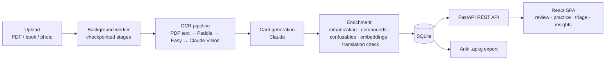

<p align="center"></p>

# Baimai

**Turn Thai textbooks, worksheets and photos of handwritten notes into spaced-repetition flashcards that you can check and correct.**

Baimai (ใบไม้, "leaf", formerly Dek-Kard) is a self-hosted web app for learners of Thai. ใบ (bai) is also the Thai word for counting cards. Upload a PDF or a photo and it OCRs the Thai text, uses Claude to pull out vocabulary and example sentences, adds romanization, compound-word breakdowns and confusable-word warnings, then schedules review with the FSRS algorithm. Cards the system is unsure about go to a triage queue so you can check them before you learn them.

[](https://github.com/James-Fry-2/Thai-flashcards-app/actions/workflows/ci.yml)
[](https://github.com/James-Fry-2/Thai-flashcards-app/releases/latest)

---

## What it does

| | |
|---|---|
| **Ingest anything** | PDFs, whole textbooks (with automatic chapter detection) and phone photos of notes. A layered OCR pipeline moves to the next engine when confidence drops: embedded PDF text → PaddleOCR → EasyOCR → Claude Vision. |
| **Generate cards** | Claude extracts vocabulary, translations, example sentences and topic tags. Duplicates are merged and corrupted OCR text is rejected before it reaches a card. |
| **Learn** | FSRS spaced repetition, scheduled separately for each direction (Thai→English, English→Thai, listening). Mixed practice sessions with multiple-choice and recall exercises. Review by deck, topic, chapter, search or "at risk" set. |
| **Understand Thai words** | RTGS, Paiboon and IPA romanization (pick one in Settings). Compound words split into glossed parts using the Volubilis dictionary. Pairs that sound or look alike are linked so you can tell them apart. |
| **Trust the content** | Possible mistranslations are flagged automatically and can be checked by an LLM. A triage screen walks through flagged cards, and your corrections are stored as overrides, so the generated original is never lost. |
| **Track progress** | Mastery bands, weak topics and chapters, error patterns, trends, XP, streaks and achievements. |
| **Take it with you** | Export any deck to Anki (`.apkg`). |

## Architecture



| Layer | Tech |
|---|---|
| Backend | Python 3.12, FastAPI, async SQLAlchemy 2, Alembic, Pydantic settings |
| Frontend | React 18, TypeScript, Vite, Tailwind CSS, React Query, Recharts, Framer Motion |
| AI / NLP | Anthropic Claude (provider abstraction, model chosen per task), PaddleOCR, EasyOCR, sentence-transformers, PyThaiNLP, wordfreq |
| Learning | FSRS scheduler, genanki |
| Delivery | Single Docker image (multi-stage build), GitHub Actions CI, release images on GHCR |

Some design choices:
- **The database is the job queue.** Upload processing runs in stages, records a checkpoint after each one and resumes after a crash or restart, without needing Redis or Celery.
- **Deterministic first, LLM second.** Compound segmentation, confusable detection and translation flagging use dictionaries and edit distance. The LLM is only called when you ask it to verify something.
- **Overrides, not edits.** Your corrections sit on top of generated cards, so a regenerated card keeps them and the original is kept for audit.
- **Romanization is computed in advance** for every scheme, so switching schemes in Settings is a column swap, not a recomputation.

---

## Quick start (prebuilt release)

You need [Docker](https://docs.docker.com/get-docker/) and an [Anthropic API key](https://console.anthropic.com/).

1. Download `dek-kard-vX.Y.Z.zip` from the [latest release](https://github.com/James-Fry-2/Thai-flashcards-app/releases/latest) and unzip it.
2. Copy `.env.example` to `.env` and set `ANTHROPIC_API_KEY` and `SECRET_KEY`.
3. Start the app:
   ```bash
   docker compose up -d
   ```
4. Open <http://localhost:8000>.

Your cards, uploads and review history are stored in `./data`. To back them up, copy that folder.

## Build from source

```bash
git clone https://github.com/James-Fry-2/Thai-flashcards-app.git
cd Thai-flashcards-app
cp .env.example .env        # set ANTHROPIC_API_KEY and SECRET_KEY
docker compose up --build
```

The optional IronOCR sidecar (commercial licence) is off by default. To start it, run `docker compose --profile ironocr up --build` and set `IRONOCR_URL=http://ironocr:5050`.

### Local development

Requires Python 3.12+ and Node 20+.

```bash
python -m venv .venv && source .venv/bin/activate
pip install -r requirements.txt
alembic upgrade head
bash scripts/dev.sh          # API on :8000, Vite dev server on :5173
```

Run the tests with `pytest`. The interactive API docs are at <http://localhost:8000/docs>.

### Optional: Thai dictionary

Compound-word glosses use the [Volubilis](http://belisan-volubilis.blogspot.com/) Thai–English dictionary. It isn't included because of its licence. Download the *VOLUBILIS DATABASE* spreadsheet yourself and load it:

```bash
python scripts/ingest_lexicon.py --source-file path/to/volubilis.xlsx --dry-run   # then rerun without --dry-run
```

Without it, everything else works and compound breakdowns are simply skipped.

## Configuration

All settings are environment variables (see [`.env.example`](.env.example)). The main ones:

| Variable | Default | Purpose |
|---|---|---|
| `ANTHROPIC_API_KEY` | *(required)* | Claude access |
| `SECRET_KEY` | *(required)* | App secret, 32+ characters |
| `CARD_GENERATION_MODEL` | `claude-opus-4-6` | Model that writes the cards |
| `*_PROVIDER` / `*_MODEL` | Claude Haiku | Model for each task: OCR fallback, tagging, compound review, translation check |
| `AZURE_SPEECH_KEY` / `AZURE_SPEECH_REGION` | *(empty)* / `southeastasia` | Thai audio via Azure Neural voices, cached in `MEDIA_DIR/tts`. Empty key turns it off |
| `OCR_CONFIDENCE_THRESHOLD` | `0.60` | Below this, OCR moves to the next engine |
| `MAX_UPLOAD_SIZE_MB` / `MAX_BOOK_UPLOAD_SIZE_MB` | `20` / `300` | Upload limits |

## Project layout

```
src/
  api/routes/     REST endpoints (cards, decks, uploads, review, practice, triage, analytics, search, export…)
  db/             SQLAlchemy models and service layer
  ocr/            Multi-engine OCR pipeline with confidence scoring
  llm/            Provider abstraction and prompts
  tasks/          Checkpointed upload worker
  practice/       Exercise registry for practice mode
  utils/          FSRS, romanization, compounds, confusables, embeddings, Anki export…
frontend/src/     React pages (Dashboard, Decks, Review, Practice, Triage, Books, Search, Settings…)
alembic/          Database migrations
tests/            pytest suite
```

See [CHANGELOG.md](CHANGELOG.md) for release history.

## Licence

Code is released under the [MIT licence](LICENSE). The Volubilis dictionary data is not part of this repository and keeps its own terms.
